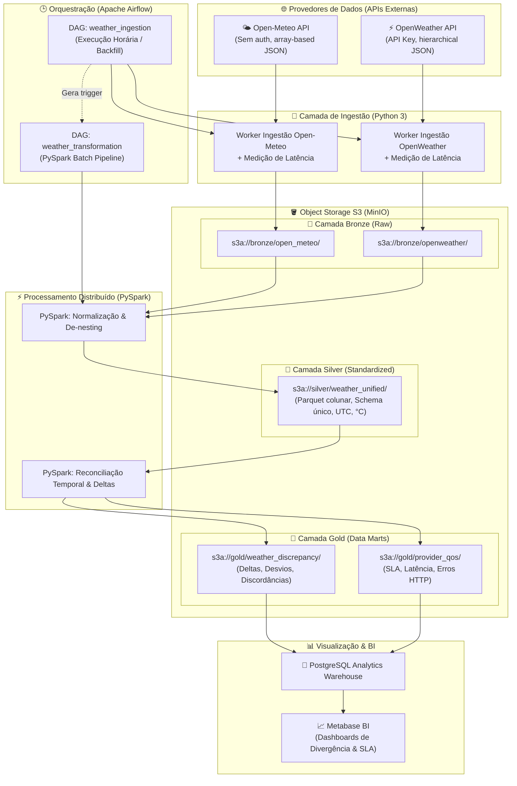

# 🌤️ MeteoSync: Integração de Dados Meteorológicos Multi-API & Análise de Divergência

> **Plataforma de Engenharia de Dados para ingestão, padronização em larga escala com PySpark, auditoria de schemas heterogêneos e análise comparativa de discrepâncias climáticas entre múltiplos provedores.**

[](https://www.python.org/)
[](https://airflow.apache.org/)
[](https://spark.apache.org/)
[](https://min.io/)
[](https://www.metabase.com/)
[](https://www.docker.com/)

---

## 📌 1. Visão Geral do Projeto

No contexto moderno de **Engenharia de Dados**, a integração e harmonização de dados provenientes de fontes externas não cooperativas (**Data Integration**) é um dos desafios mais frequentes e críticos. Cada fornecedor de dados opera com seus próprios padrões de transporte, ontologias, granularidades temporais, unidades de medida e contratos de schema.

O **MeteoSync** foi projetado para resolver e demonstrar esse desafio de ponta a ponta:
* **Consumo Multi-Source:** Ingestão paralela de duas das maiores APIs de meteorologia do mundo:
  * **Open-Meteo:** Dados abertos de modelagem numérica em estrutura de arrays paralelos.
  * **OpenWeather:** API comercial amplamente utilizada com payloads de objetos aninhados e timestamps em Unix Epoch.
* **Cobertura Geográfica:** 10 capitais estratégicas brasileiras (Teresina, São Paulo, Rio de Janeiro, Brasília, Salvador, Recife, Manaus, Porto Alegre, Curitiba e Belém).
* **Frequência e Janela:** Coleta horária automatizada ao longo de um histórico contínuo de 30 dias.
* **Arquitetura Medalhão (Lakehouse):** Preservação total dos dados brutos no **MinIO S3** (Bronze), limpeza e normalização colunar com **PySpark** (Silver) e agregação de divergências analíticas e indicadores de qualidade (Gold).
* **Camada de Decisão:** Dashboards analíticos no **Metabase** respondendo qual provedor é mais consistente, onde ocorrem as maiores anomalias e qual a latência/disponibilidade real de cada API.

---

## 🏗️ 2. Arquitetura do Sistema

O pipeline segue a metodologia **ELT (Extract, Load, Transform)** desacoplada e orquestrada pelo **Apache Airflow**:



---

## 🔍 3. Mapeamento e Harmonização de Schemas

A tabela a seguir resume as principais transformações aplicadas pelo **PySpark** para converter os dados brutos heterogêneos no **Esquema Canônico Unificado**:

| Dimensão / Métrica | Open-Meteo (Raw) | OpenWeather (Raw) | Schema Unificado (Silver) | Unidade / Formato Padronizado |
| :--- | :--- | :--- | :--- | :--- |
| **Identificador Cidade** | `latitude`, `longitude` | `name`, `id` | `city_id` | `VARCHAR` (ex: `teresina`, `sao_paulo`) |
| **Timestamp** | `hourly.time` (ISO 8601 string) | `dt` (Unix Epoch seconds) | `timestamp_utc` | `TIMESTAMP` (UTC ISO 8601) |
| **Temperatura** | `hourly.temperature_2m` | `main.temp` | `temperature_celsius` | `DOUBLE` em Graus Celsius (°C) |
| **Umidade Relativa** | `hourly.relative_humidity_2m` | `main.humidity` | `humidity_pct` | `INT` (0% a 100%) |
| **Pressão Atmosférica** | `hourly.surface_pressure` | `main.pressure` | `pressure_hpa` | `DOUBLE` em Hectopascal (hPa) |
| **Velocidade do Vento** | `hourly.wind_speed_10m` | `wind.speed` | `wind_speed_kmh` | `DOUBLE` em km/h |
| **Condição de Tempo** | `hourly.weather_code` (WMO) | `weather[0].main` / `.id` | `weather_condition` | `VARCHAR` (`CLEAR`, `CLOUDY`, `RAIN`, etc.) |
| **Provedor de Origem** | Metadata fixo | Metadata fixo | `provider` | `VARCHAR` (`open_meteo` ou `openweather`) |

---

## 📁 4. Estrutura de Diretórios do Repositório

```text
meteosync/
├── .env.example               # Template de variáveis de ambiente
├── .gitignore                 # Arquivos ignorados pelo Git
├── docker-compose.yml         # Definição dos containers (Airflow, Postgres, MinIO, Metabase)
├── Dockerfile.spark           # Imagem Spark 3.5.1 com suporte S3A para MinIO
├── pyproject.toml             # Dependências e metadados do projeto Python
├── README.md                  # Este arquivo (guia completo da aplicação)
│
├── config/                    # Configurações globais
│   ├── __init__.py
│   └── cities.py              # Catálogo das 10 capitais monitoradas e coordenadas
│
├── dags/                      # DAGs de orquestração do Apache Airflow
│   ├── __init__.py
│   ├── weather_ingestion.py   # DAG de ingestão horária multi-API para a camada Bronze
│   └── weather_transform.py   # DAG de acionamento dos jobs PySpark (Silver & Gold)
│
├── docs/                      # Documentações especializadas
│   ├── ARCHITECTURE.md        # Especificação detalhada de arquitetura e engenharia de dados
│   └── TASKS.md               # Backlog de tarefas e plano de implementação (WBS)
│
├── jobs/                      # Scripts e pipelines Apache Spark / PySpark
│   ├── spark_bronze_to_silver.py  # Unflatten, conversão de unidades e deduplicação
│   └── spark_silver_to_gold.py    # Reconciliação temporal, deltas e telemetria de QoS
│
└── scripts/                   # Módulos Python de ingestão e utilitários
    ├── __init__.py
    ├── ingest_open_meteo.py   # Extrator Open-Meteo com telemetria
    ├── ingest_openweather.py  # Extrator OpenWeather com tratamento de rate limit
    └── utils/
        ├── __init__.py
        └── s3_client.py       # Wrapper de integração com MinIO S3 via boto3
```

---

## 🚀 5. Guia de Instalação e Execução

### 5.1. Pré-requisitos
* **Docker Engine** 24.0+ e **Docker Compose** 2.20+ instalados.
* **Python** 3.10+ (ou gerenciador `uv` / `virtualenv`).
* Chave de API gratuita da [OpenWeather](https://openweathermap.org/api) (para a variável `OPENWEATHER_API_KEY`).

### 5.2. Configuração do Ambiente

1. Clone o repositório ou navegue para o diretório raiz:
   ```bash
   cd c:\project\meteosync
   ```

2. Crie o arquivo local de variáveis sem sobrescrever um `.env` existente:
   ```powershell
   if (!(Test-Path .env)) { Copy-Item .env.example .env }
   ```

3. Edite o `.env` e preencha as senhas e chaves necessárias. Gere uma chave Fernet para o Airflow e segredos aleatórios para as aplicações:
   ```dotenv
   OPENWEATHER_API_KEY=
   AIRFLOW_DB_USER=airflow
   AIRFLOW_DB_PASSWORD=senha_url_safe
   AIRFLOW_DB_NAME=airflow
   AIRFLOW_ADMIN_USERNAME=admin
   AIRFLOW_ADMIN_PASSWORD=sua_senha
   AIRFLOW_FERNET_KEY=chave_fernet
   AIRFLOW_WEBSERVER_SECRET_KEY=segredo_webserver
   MINIO_ROOT_USER=minioadmin
   MINIO_ROOT_PASSWORD=sua_senha
   MINIO_ENDPOINT_URL=http://minio:9000
   METABASE_DB_USER=metabase
   METABASE_DB_PASSWORD=sua_senha
   METABASE_DB_NAME=metabase
   METABASE_SESSION_SECRET_KEY=segredo_de_sessao
   ```

   Gere a chave Fernet com:
   ```powershell
   python -c "import base64,secrets; print(base64.urlsafe_b64encode(secrets.token_bytes(32)).decode())"
   ```
   Para os outros segredos, use senhas aleatórias URL-safe. Não compartilhe nem versione o `.env`.

### 5.3. Inicialização dos Serviços

Suba o cluster completo via Docker Compose:
```bash
docker compose up -d
```

O Compose constrói a imagem do Airflow com as dependências dos ingestors na primeira execução.

### 5.4. Portas de Acesso às Interfaces Web

| Serviço | URL | Credenciais Padrão |
| :--- | :--- | :--- |
| **Apache Airflow Webserver** | [http://localhost:8080](http://localhost:8080) | Credenciais definidas em `AIRFLOW_ADMIN_USERNAME` e `AIRFLOW_ADMIN_PASSWORD` |
| **MinIO Console (S3 Web)** | [http://localhost:9001](http://localhost:9001) | Credenciais definidas em `MINIO_ROOT_USER` e `MINIO_ROOT_PASSWORD` |
| **Metabase BI** | [http://localhost:3000](http://localhost:3000) | Configuração via setup wizard inicial |
| **PostgreSQL Database** | `localhost:5432` | Usuário: `airflow` \| Senha: `airflow` |

---

## ⚡ 6. Execução e Validação dos Pipelines

### 6.1. Execução via Airflow
1. Acesse o Airflow em `http://localhost:8080`.
2. Ative a DAG **`meteosync_weather_ingestion`**.
3. Dispare manualmente a DAG com o botão **Trigger DAG** ou aguarde o agendamento horário.
4. Os dados serão gravados nos buckets do MinIO em formato particionado.

### 6.2. Execução Manual via Linha de Comando (Testes Locais)
Você pode executar a ingestão diretamente no terminal:
```bash
# Ingestão Open-Meteo
python -m scripts.ingest_open_meteo

# Ingestão incremental da última hora disponível em UTC
python -m scripts.ingest_open_meteo --incremental

# Execução histórica (até 30 dias)
python -m scripts.ingest_open_meteo --start-date 2026-10-01 --end-date 2026-10-30

# Ingestão OpenWeather
python -m scripts.ingest_openweather
```

---

## 📊 7. Insights e Análises Disponíveis no Metabase

Com a camada **Gold** populada, os seguintes dashboards e respostas de negócio ficam imediatamente disponíveis:

1. **Dashboard de Divergência Térmica:**
   * **Diferencial de Temperatura ($\Delta T$):** Comparação horária direta $T_{\text{Open-Meteo}} - T_{\text{OpenWeather}}$.
   * **Erro Médio Absoluto (MAE):** Dispersão térmica média por cidade.
   * **Top Cidades Divergentes:** Identificação das capitais onde os modelos climáticos mais discordam entre si (ex: Teresina vs Curitiba).
2. **Dashboard de Confiabilidade e Condições Extremas:**
   * **Discordância de Precipitação:** Casos em que um provedor previu chuva intensa e o outro céu limpo.
   * **Divergência de Vento e Umidade:** Variações nas medições de pressão e velocidade do vento.
3. **Dashboard de Telemetria e SLA das APIs:**
   * **Disponibilidade (Uptime %):** Monitoramento contínuo de status HTTP 200 vs 4xx/5xx.
   * **Latência de Resposta:** Tempo médio de resposta (ms) de cada API.

---

## 📚 8. Documentação Técnica Detalhada

Para aprofundamento nos aspectos conceituais, de arquitetura e do plano de tarefas:

* 📄 [**Especificação de Arquitetura e Engenharia de Dados (`docs/ARCHITECTURE.md`)**](file:///c:/project/meteosync/docs/ARCHITECTURE.md): Detalhamento matemático de métricas de resíduos, design de particionamento, idempotência e tratamento de falhas.
* 📋 [**Documentação de Tasks e Backlog de Implementação (`docs/TASKS.md`)**](file:///c:/project/meteosync/docs/TASKS.md): Detalhamento da WBS (Work Breakdown Structure), matriz MoSCoW e plano faseado de desenvolvimento.

---

## 👥 Contribuição e Licença

Desenvolvido para demonstração de excelência em **Data Integration & Modern Data Stack Engineering**.
Distribuído sob licença MIT.

