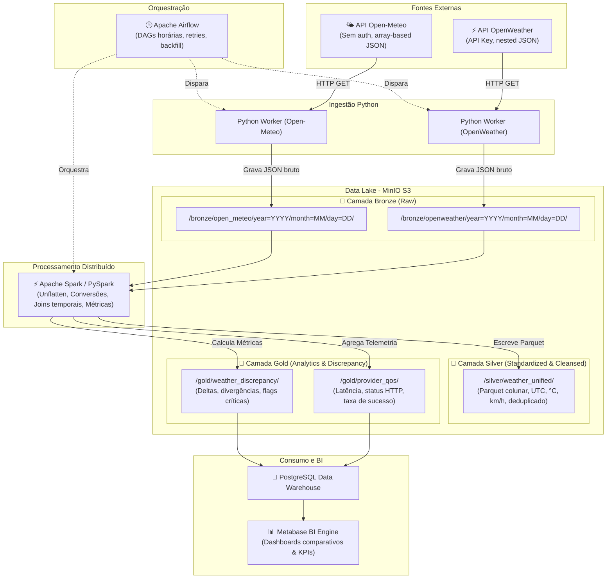
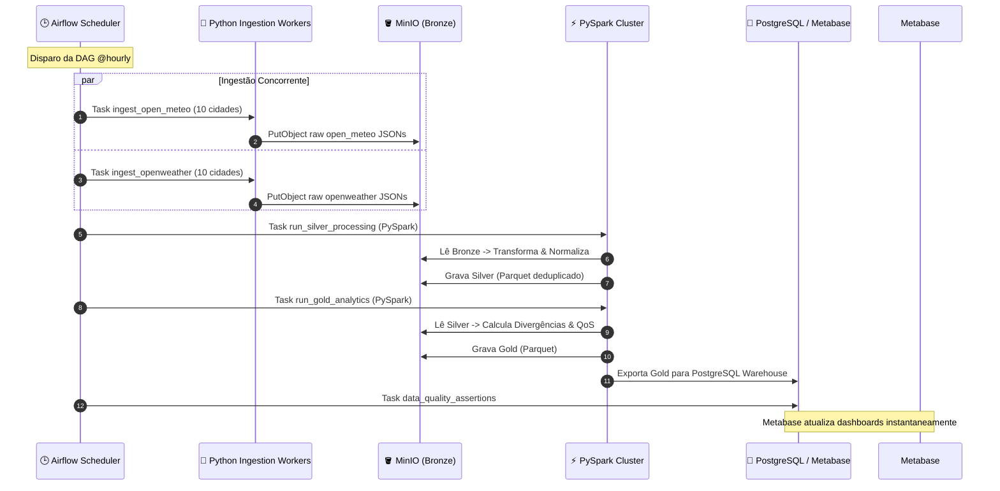

# 🏛️ Especificação de Arquitetura e Engenharia de Dados
## Projeto MeteoSync: Integração Multi-API & Pipeline de Análise de Discrepância

---

### 1. Visão Geral e Motivação do Projeto

No ecossistema de Engenharia de Dados corporativo, é comum que equipes de negócios necessitem de informações de um mesmo domínio conceitual provenientes de múltiplos fornecedores externos ou sistemas legados independentes. Cada provedor possui seus próprios modelos de dados, frequências de atualização, convenções de unidades de medida e níveis de serviço (SLA).

O **MeteoSync** implementa uma solução completa de **Data Integration (Integração e Padronização de Dados)**, capturando dados meteorológicos de duas das principais APIs públicas globais:
1. **Open-Meteo** (Modelo numérico aberto, sem necessidade de autenticação).
2. **OpenWeather** (Serviço comercial consagrado, baseado em autenticação por API Key).

O objetivo central não é apenas coletar previsões climáticas, mas sim:
* **Demonstrar a integração de esquemas heterogêneos** em um modelo canônico único.
* **Preservar a fidelidade da fonte bruta** (Bronze Layer) para auditoria e reprocessamento.
* **Processar e harmonizar os dados em larga escala** com Apache Spark / PySpark (Silver Layer).
* **Gerar métricas analíticas e identificar divergências quantitativas e semânticas** entre os provedores (Gold Layer).
* **Avaliar a telemetria e o SLA dos serviços** (taxa de erro, latência e disponibilidade).

---

### 2. Arquitetura de Alto Nível (Medallion Lakehouse)

A arquitetura adota o paradigma **ELT (Extract - Load - Transform)** desacoplado, utilizando a arquitetura em medalhão (Bronze $\rightarrow$ Silver $\rightarrow$ Gold) sobre armazenamento de objetos compatível com S3 (MinIO):



---

### 3. Análise e Comparação de Schemas das Fontes

As duas APIs apresentam divergências profundas em sua modelagem de dados:

#### 3.1. Estrutura do Payload: Open-Meteo
A Open-Meteo utiliza uma estrutura de **arrays paralelos** sob o nó `hourly`, onde cada índice corresponde ao mesmo instante no tempo para todas as variáveis meteorológicas:

```json
{
  "latitude": -5.0892,
  "longitude": -42.8019,
  "elevation": 72.0,
  "timezone": "UTC",
  "hourly_units": {
    "time": "iso8601",
    "temperature_2m": "°C",
    "relative_humidity_2m": "%",
    "surface_pressure": "hPa",
    "wind_speed_10m": "km/h",
    "weather_code": "wmo code"
  },
  "hourly": {
    "time": ["2026-11-11T00:00", "2026-11-11T01:00"],
    "temperature_2m": [26.4, 25.8],
    "relative_humidity_2m": [82, 85],
    "surface_pressure": [1008.2, 1008.5],
    "wind_speed_10m": [7.2, 5.4],
    "weather_code": [0, 1]
  }
}
```

#### 3.2. Estrutura do Payload: OpenWeather
A OpenWeather utiliza objetos aninhados hierárquicos com arrays de elementos para condições de tempo e Unix Timestamps (`dt`):

```json
{
  "coord": { "lon": -42.8019, "lat": -5.0892 },
  "weather": [
    {
      "id": 801,
      "main": "Clouds",
      "description": "few clouds",
      "icon": "02d"
    }
  ],
  "main": {
    "temp": 305.15,
    "feels_like": 308.2,
    "temp_min": 304.15,
    "temp_max": 305.15,
    "pressure": 1009,
    "humidity": 60
  },
  "visibility": 10000,
  "wind": {
    "speed": 3.6,
    "deg": 70
  },
  "dt": 1794441600,
  "sys": { "country": "BR" },
  "name": "Teresina"
}
```

---

#### 3.3. Matriz de Equivalência e Normalização de Schemas

| Conceito de Negócio | Open-Meteo (Raw) | OpenWeather (Raw) | Tipo Canônico | Unidade Canônica | Regra de Transformação PySpark |
| :--- | :--- | :--- | :--- | :--- | :--- |
| **Identificador Cidade** | Coordenadas/Metadata | `name` ou `id` | `StringType` | Slug único | Lookup via `(latitude, longitude)` para `city_id` |
| **Data/Hora da Medição** | `hourly.time[i]` | `dt` | `TimestampType` | UTC ISO 8601 | `to_timestamp()` no formato ISO vs `from_unixtime(dt)` |
| **Temperatura** | `hourly.temperature_2m[i]` | `main.temp` | `DoubleType` | Graus Celsius (°C) | Se OpenWeather em Kelvin: $T_{°C} = T_K - 273.15$ |
| **Sensação Térmica** | `hourly.apparent_temperature` | `main.feels_like` | `DoubleType` | Graus Celsius (°C) | $T_{°C} = T_K - 273.15$ |
| **Umidade Relativa** | `hourly.relative_humidity_2m[i]` | `main.humidity` | `IntegerType` | Porcentagem (%) | Cast direto para inteiro entre 0 e 100 |
| **Pressão Atmosférica** | `hourly.surface_pressure[i]` | `main.pressure` | `DoubleType` | Hectopascal (hPa) | Cast para numérico decimal |
| **Velocidade do Vento** | `hourly.wind_speed_10m[i]` | `wind.speed` | `DoubleType` | km/h | Se OpenWeather em m/s: $V_{\text{km/h}} = V_{\text{m/s}} \times 3.6$ |
| **Código da Condição** | `hourly.weather_code[i]` | `weather[0].id` | `IntegerType` | ID original | Preservado |
| **Condição Textual** | De-para WMO $\rightarrow$ Texto | `weather[0].main` | `StringType` | Categoria padrão | De-para padronizado (Clear, Clouds, Rain, etc.) |

---

### 4. Ciclo de Vida dos Dados por Camada (Medallion Layers)

#### 4.1. Camada Bronze (Raw Ingestion)
* **Propósito:** Armazenamento fiel dos dados brutos recebidos dos endpoints HTTP, sem nenhuma mutação ou filtragem.
* **Formato:** JSON puro.
* **Particionamento:**
  `s3a://bronze/<provider>/year=YYYY/month=MM/day=DD/hour=HH/<provider>_<city_id>_<timestamp>.json`
* **Metadados de Ingestão Injetados:**
  * `_ingestion_timestamp`: Momento exato em que a chamada de rede ocorreu.
  * `_http_status_code`: Código HTTP retornado (ex: 200, 429, 500).
  * `_response_time_ms`: Duração da chamada de rede em milissegundos.
  * `_endpoint_url`: URL e query params chamados.

#### 4.2. Camada Silver (Standardized & Cleansed)
* **Propósito:** Dados estruturados, com tipos estritos, unidades padronizadas e deduplicados.
* **Formato:** Apache Parquet (compressão Snappy) ou Delta Lake.
* **Schema Canônico (`silver_weather_unified`):**
  * `city_id` (`STRING`): Identificador normalizado da cidade (ex: `teresina`, `sao_paulo`).
  * `city_name` (`STRING`): Nome legível.
  * `state` (`STRING`): UF (ex: `PI`, `SP`).
  * `latitude` (`DOUBLE`), `longitude` (`DOUBLE`).
  * `timestamp_utc` (`TIMESTAMP`): Instante da previsão/medição arredondado para a hora.
  * `provider` (`STRING`): `open_meteo` ou `openweather`.
  * `temperature_celsius` (`DOUBLE`): Temperatura em °C.
  * `humidity_pct` (`INTEGER`): Umidade relativa em %.
  * `pressure_hpa` (`DOUBLE`): Pressão em hPa.
  * `wind_speed_kmh` (`DOUBLE`): Velocidade do vento em km/h.
  * `weather_condition` (`STRING`): Categoria semântica harmonizada (`CLEAR`, `CLOUDY`, `RAIN`, `THUNDERSTORM`, `FOG`).
  * `ingestion_timestamp` (`TIMESTAMP`).

#### 4.3. Camada Gold (Business & Discrepancy Analytics)
* **Propósito:** Tabelas analíticas agregadas, união de registros correspondentes no tempo e métricas de divergência.
* **Tabela 1: `gold_weather_discrepancy`**
  União temporal (`FULL OUTER JOIN` em `city_id` + `timestamp_utc` entre as duas fontes):
  * `delta_temperature`: $T_{\text{open\_meteo}} - T_{\text{openweather}}$
  * `abs_delta_temperature`: $|T_{\text{open\_meteo}} - T_{\text{openweather}}|$
  * `delta_humidity`: $U_{\text{open\_meteo}} - U_{\text{openweather}}$
  * `abs_delta_humidity`: $|U_{\text{open\_meteo}} - U_{\text{openweather}}|$
  * `delta_wind_speed`: $V_{\text{open\_meteo}} - V_{\text{openweather}}$
  * `is_condition_divergent`: Flag indicando se um fornecedor categorizou chuva e o outro tempo limpo.
  * `is_severe_temperature_divergence`: Flag indicando se $|\Delta T| \ge 2.5^\circ\text{C}$.
* **Tabela 2: `gold_provider_qos`**
  Telemetria das APIs:
  * Agrupamento por provedor e data.
  * Disponibilidade percentual ($\frac{\text{requisições válidas}}{\text{total de requisições}} \times 100$).
  * Latência média e percentil 95 ($P95$).

---

### 5. Fórmulas e Métricas de Engenharia

Para avaliar matematicamente a concordância e acurácia relativa entre os dois modelos meteorológicos, o pipeline PySpark calcula:

1. **Diferença Pontual de Temperatura ($\Delta T$):**
   $$\Delta T_{i} = T_{\text{open\_meteo}, i} - T_{\text{openweather}, i}$$

2. **Erro Médio Absoluto (MAE - Mean Absolute Error):**
   $$\text{MAE}_T = \frac{1}{N} \sum_{i=1}^{N} |T_{\text{open\_meteo}, i} - T_{\text{openweather}, i}|$$

3. **Raiz do Erro Quadrático Médio (RMSE - Root Mean Square Error):**
   $$\text{RMSE}_T = \sqrt{\frac{1}{N} \sum_{i=1}^{N} (T_{\text{open\_meteo}, i} - T_{\text{openweather}, i})^2}$$

4. **Taxa de Disponibilidade (Availability SLA):**
   $$\text{Availability} = \frac{\sum \text{Sucessos (HTTP 200)}}{\text{Total de Requisições}} \times 100\%$$

---

### 6. Estratégia de Orquestração com Apache Airflow

O Apache Airflow atua como o maestro de todo o fluxo operacional:



#### Propriedades Críticas de Engenharia:
1. **Idempotência Garantida:** Reexecutar qualquer DAG para uma data passada não gera dados duplicados nem altera o histórico indevidamente. O particionamento temporal no MinIO e no Spark substitui ou reconcilia deterministicamente por `(city_id, timestamp_utc, provider)`.
2. **Backfill Automatizado:** O pipeline aceita parâmetros de data inicial e final (`start_date`, `end_date`), permitindo recuperar o histórico dos 30 dias rapidamente.
3. **Isolamento de Falhas:** Falhas em chamadas de rede da OpenWeather (por exemplo, esgotamento de cota) geram registros de erro na telemetria, mas não abortam a ingestão da Open-Meteo nem corrompem a camada Silver.

