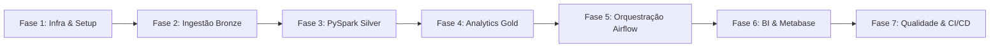

# 📋 Documentação de Tarefas e Backlog de Implementação (WBS)
## Projeto MeteoSync: Integração Multi-API & Análise de Divergência Meteorológica

---

### 1. Visão Geral do Plano de Implementação

O projeto **MeteoSync** tem como propósito demonstrar a competência crítica de **Integração e Padronização de Dados (Data Integration)** a partir de duas fontes externas heterogêneas (**Open-Meteo** e **OpenWeather**), para 10 cidades brasileiras com coletas horárias contínuas ao longo de 30 dias.

A entrega técnica é dividida em **7 Fases Sequenciais e Incrementais**, aplicando as melhores práticas de Engenharia de Dados, arquitetura de Lakehouse (Medalhão) e orquestração profissional.

---

### 2. Matriz de Tarefas por Fase

---

#### 🟢 Fase 1: Infraestrutura de Dados & Configuração do Ambiente

**Objetivo:** Estabelecer o ambiente conteinerizado via Docker Compose com todos os componentes da Modern Data Stack locais e funcionais.

- [x] **TASK-1.1: Atualização do Docker Compose com Stack Completa**
  - **Descrição:** Expandir o `docker-compose.yml` para incluir além do Airflow e Postgres:
    - **MinIO Object Storage** (portas 9000 para API S3 e 9001 para Web Console).
    - **MinIO Bucket Initializer** (container de vida curta para criar os buckets `bronze`, `silver` e `gold`).
    - **Metabase** (porta 3000) conectado ao banco de dados analítico ou Postgres.
    - **Apache Spark / PySpark Runner** (imagem compatível com Spark 3.5+ e Python 3.10/3.11 com jars Hadoop AWS/S3A).
  - **Critérios de Aceite:**
    - `docker compose up -d` sobe todos os serviços sem erros de conectividade.
    - Healthchecks válidos para Postgres, MinIO e Airflow.

- [x] **TASK-1.2: Gerenciamento de Segredos e `.env`**
  - **Descrição:** Parametrizar todas as variáveis de ambiente sensíveis e de conexão:
    - Chave da API OpenWeather (`OPENWEATHER_API_KEY`).
    - Credenciais MinIO (`MINIO_ROOT_USER`, `MINIO_ROOT_PASSWORD`, `MINIO_ENDPOINT_URL`).
    - Credenciais Airflow e Postgres.
  - **Critérios de Aceite:**
    - `.env.example` atualizado sem credenciais reais.
    - `.env` ignorado no `.gitignore`.

- [x] **TASK-1.3: Catálogo de Cidades e Metadados Geográficos**
  - **Descrição:** Consolidar em `config/cities.py` as 10 capitais brasileiras selecionadas com coordenadas precisas (latitude, longitude), estado, identificador único slug (`city_id`), timezone local e fuso horário oficial.
  - **Cidades-Alvo:** Teresina (PI), São Paulo (SP), Rio de Janeiro (RJ), Brasília (DF), Salvador (BA), Recife (PE), Manaus (AM), Porto Alegre (RS), Curitiba (PR), Belém (PA).
  - **Critérios de Aceite:**
    - Estrutura de dados validada em Python com testes de integridade de coordenadas (-90 a 90 / -180 a 180).

---

#### 🟡 Fase 2: Ingestão de Dados (Camada Bronze - Raw Data Lake)

**Objetivo:** Consumir as APIs Open-Meteo e OpenWeather de forma resiliente, registrando telemetria de rede e persistindo os JSONs originais íntegros no MinIO S3.

- [ ] **TASK-2.1: Desenvolvimento do Ingestor Open-Meteo (`scripts/ingest_open_meteo.py`)**
  - **Descrição:** Implementar cliente HTTP com `requests` ou `urllib3` com retry automático (exponential backoff) para a endpoint Forecast/Archive da Open-Meteo.
  - **Parâmetros de Requisição:** `latitude`, `longitude`, `hourly=temperature_2m,relative_humidity_2m,precipitation,surface_pressure,wind_speed_10m,weather_code`, `timezone=UTC`.
  - **Captura de Metadados de Ingestão:** Timestamp de requisição, status code, tempo de resposta em milissegundos (latência) e tamanho do payload.
  - **Persistência Bronze:** Gravar o arquivo raw no bucket `s3a://bronze/open_meteo/year=YYYY/month=MM/day=DD/open_meteo_{city_id}_{timestamp}.json`.
  - **Critérios de Aceite:**
    - Suporte a execução histórica (batch de até 30 dias retroativos) e execução incremental (hora corrente).
    - Logs detalhados em stdout e em arquivo.

- [ ] **TASK-2.2: Desenvolvimento do Ingestor OpenWeather (`scripts/ingest_openweather.py`)**
  - **Descrição:** Implementar cliente HTTP para a API OpenWeather (endpoints Current Weather API ou 5-day / 3-hour forecast / Timemachine de acordo com a chave contratada/gratuita).
  - **Parâmetros de Requisição:** `lat`, `lon`, `appid={OPENWEATHER_API_KEY}`, `units=standard` (Kelvin para conversão explícita no PySpark) ou `units=metric`.
  - **Captura de Metadados de Ingestão:** Timestamp de requisição, latência em ms, HTTP status code e erro caso quota seja excedida.
  - **Persistência Bronze:** Gravar payload raw íntegro no bucket `s3a://bronze/openweather/year=YYYY/month=MM/day=DD/openweather_{city_id}_{timestamp}.json`.
  - **Critérios de Aceite:**
    - Tratamento explícito de `HTTP 429` (Rate Limit) e `HTTP 401` (Invalid API Key).
    - Preservação intacta da árvore JSON hierárquica original (`main`, `wind`, `weather[0]`, `sys`, etc.).

- [ ] **TASK-2.3: Módulo Utilitário de Conexão com Object Storage (`scripts/utils/s3_client.py`)**
  - **Descrição:** Criar wrapper reutilizável sobre a biblioteca `boto3` para upload, listagem e verificação de integridade de arquivos no MinIO.
  - **Critérios de Aceite:**
    - Idempotência: não sobrescrever arquivos sem flag explícita.
    - Fallback para salvamento em disco local (`data/raw/`) caso MinIO esteja temporariamente inacessível durante desenvolvimento local.

---

#### 🟠 Fase 3: Processamento e Padronização Distribuída com PySpark (Camada Silver)

**Objetivo:** Transformar os JSONs brutos heterogêneos em conjuntos de dados padronizados, limpos e harmonizados em formato colunar Parquet/Delta.

- [ ] **TASK-3.1: Configuração da Sessão PySpark com Suporte a S3A**
  - **Descrição:** Configurar `SparkSession` com pacotes necessários:
    - `org.apache.hadoop:hadoop-aws:3.3.4`
    - `com.amazonaws:aws-java-sdk-bundle:1.12.262`
    - Configurações S3A: `fs.s3a.endpoint`, `fs.s3a.access.key`, `fs.s3a.secret.key`, `fs.s3a.path.style.access=true`.
  - **Critérios de Aceite:**
    - PySpark consegue ler e escrever diretamente nos buckets `bronze`, `silver` e `gold` do MinIO.

- [ ] **TASK-3.2: Pipeline PySpark para Open-Meteo (`jobs/spark_bronze_to_silver_open_meteo.py`)**
  - **Descrição:**
    - Leitura dos JSONs da partição correspondente.
    - Explodir (`explode`) as colunas em formato array paralelo (`hourly.time`, `hourly.temperature_2m`, etc.) em registros tabulares individuais por hora.
    - Conversão do timestamp de string ISO 8601 para `TimestampType` padronizado em UTC.
    - Castings de tipos numéricos (`DoubleType` para temperatura, vento, pressão; `IntegerType` para umidade e código meteorológico).
    - Adição de colunas de auditoria: `source_provider = 'open_meteo'`, `ingestion_timestamp`.
  - **Critérios de Aceite:**
    - Gravação em `s3a://silver/weather_normalized/provider=open_meteo/` particionado por `year`, `month`, `day`.

- [ ] **TASK-3.3: Pipeline PySpark para OpenWeather (`jobs/spark_bronze_to_silver_openweather.py`)**
  - **Descrição:**
    - Leitura dos JSONs brutos da OpenWeather.
    - Achatar (flattening) das estruturas aninhadas: `main.temp`, `main.humidity`, `main.pressure`, `wind.speed`, `weather[0].id`, `weather[0].main`.
    - Conversão de unidades:
      - Temperatura: Conversão de Kelvin para Celsius ($T_{°C} = T_K - 273.15$) caso a API tenha retornado padrão Kelvin.
      - Vento: Padronização da velocidade para km/h ou m/s com precisão decimal.
    - Conversão de `dt` (Unix epoch em segundos) para `TimestampType` UTC.
    - Adição de colunas de auditoria: `source_provider = 'openweather'`, `ingestion_timestamp`.
  - **Critérios de Aceite:**
    - Gravação em `s3a://silver/weather_normalized/provider=openweather/` particionado por `year`, `month`, `day`.

- [ ] **TASK-3.4: Reconciliação e Unificação em Schema Canônico (`jobs/spark_silver_integration.py`)**
  - **Descrição:**
    - Unir as duas fontes padronizadas sob uma tabela canônica unificada (`silver_weather_unified`).
    - Validação de chave primária composta: `(city_id, timestamp_utc, provider)`.
    - Eliminação de duplicatas via janela analítica (`row_number() over (partition by city_id, timestamp_utc, provider order by ingestion_timestamp desc)`).
  - **Critérios de Aceite:**
    - Dados consistentes sem duplicações, com schemas exatamente idênticos para ambas as fontes.

---

#### 🔵 Fase 4: Engenharia de Features & Analytics (Camada Gold)

**Objetivo:** Cruzar registros temporais idênticos de ambos os provedores e calcular indicadores analíticos de divergência e qualidade de dados.

- [ ] **TASK-4.1: Cruzamento Temporal dos Provedores (Full Outer / Inner Reconciliation)**
  - **Descrição:** Realizar `FULL OUTER JOIN` entre medições da Open-Meteo e OpenWeather pela chave `(city_id, timestamp_utc)`.
  - **Critérios de Aceite:**
    - Identificação precisa de quando uma medição existe em A mas falta em B (análise de incompletude/disponibilidade).

- [ ] **TASK-4.2: Cálculo das Métricas de Divergência Climática**
  - **Descrição:** Criar tabela `gold_weather_discrepancy` com os seguintes cálculos:
    - $\Delta \text{Temperatura} = T_{\text{open\_meteo}} - T_{\text{openweather}}$ (°C)
    - $|\Delta \text{Temperatura}|$ (Desvio Absoluto de Temperatura)
    - $\Delta \text{Umidade} = U_{\text{open\_meteo}} - U_{\text{openweather}}$ (pontos percentuais)
    - $|\Delta \text{Vento}| = |V_{\text{open\_meteo}} - V_{\text{openweather}}|$
    - $\Delta \text{Pressão} = P_{\text{open\_meteo}} - P_{\text{openweather}}$ (hPa)
    - Flag booleana de Alta Divergência: `is_high_temp_divergence = (|delta_temp| > 2.0)`
    - Flag de Incompatibilidade de Condição: divergência semântica entre chuva vs. céu limpo.
  - **Critérios de Aceite:**
    - Tabela gravada em Parquet no bucket `s3a://gold/weather_discrepancy/` e replicada/acessível via Postgres/Trino para o Metabase.

- [ ] **TASK-4.3: Tabela de Telemetria e Qualidade de Serviço (SLA / QoS das APIs)**
  - **Descrição:** Criar tabela `gold_provider_qos` agrupada por `(provider, date)` com:
    - Total de chamadas realizadas.
    - Taxa de sucesso (HTTP 200) vs. falhas (HTTP 4xx, 5xx, timeouts).
    - Latência média, mediana e percentil 95 (P95) em milissegundos.
    - Taxa de completude de atributos por cidade.
  - **Critérios de Aceite:**
    - Métricas diárias consolidadas prontas para consumo em relatórios executivos.

---

#### 🟣 Fase 5: Orquestração e Agendamento no Apache Airflow

**Objetivo:** Criar DAGs robustas, idempotentes e com suporte a backfill para automatizar o pipeline de hora em hora.

- [ ] **TASK-5.1: Refatoração da DAG de Ingestão (`dags/dag_weather_ingestion.py`)**
  - **Descrição:**
    - Alterar agendamento para horário (`@hourly` ou `0 * * * *`).
    - Configurar execução paralela das tarefas `ingest_open_meteo` e `ingest_openweather`.
    - Passagem do parâmetro de execução temporal (`logical_date` / `execution_date`) para os scripts, garantindo que o backfill busque exatamente a hora agendada.
  - **Critérios de Aceite:**
    - Execução idempotente (reexecutar a DAG não duplica dados no Bronze).

- [ ] **TASK-5.2: DAG de Processamento PySpark (`dags/dag_weather_transformation.py`)**
  - **Descrição:**
    - Configuração de `SparkSubmitOperator` ou `BashOperator` invocando o job Spark local/Docker.
    - Sequenciamento: `ingestion_sensor` -> `bronze_to_silver` -> `silver_to_gold` -> `quality_checks`.
  - **Critérios de Aceite:**
    - O processamento só inicia após as duas coletas da hora estarem finalizadas com sucesso.

- [ ] **TASK-5.3: Tratamento de Erros, Alertas e Retries**
  - **Descrição:**
    - Configurar 3 retries com intervalo de 2 minutos para falhas transitórias de conexão de rede externa.
    - Handlers de `on_failure_callback` para log detalhado de incidentes.
  - **Critérios de Aceite:**
    - Falha em uma cidade específica não interrompe a coleta das outras 9 cidades.

---

#### 🔴 Fase 6: Camada de Visualização e Dashboards no Metabase

**Objetivo:** Construir dashboards interativos que permitam ao usuário e stakeholders analisar discrepâncias climáticas e confiabilidade das APIs.

- [ ] **TASK-6.1: Conexão do Metabase com a Camada Analítica**
  - **Descrição:** Configurar fonte de dados no Metabase apontando para a base analítica (PostgreSQL Data Warehouse sincronizado da camada Gold ou Trino sobre o MinIO S3).
  - **Critérios de Aceite:**
    - Schema sincronizado com tipos de dados de data, numérico e coordenadas geográficas reconhecidos.

- [ ] **TASK-6.2: Construção do Dashboard de Divergência Climática**
  - **Visões e Gráficos:**
    - **KPI Cards:** Divergência Média de Temperatura (°C), Divergência Máxima Observada, Índice Médio de Concordância entre Provedores.
    - **Série Temporal de Comparação:** Linhas sobrepostas de $T_{\text{open\_meteo}}$ vs. $T_{\text{openweather}}$ ao longo das horas para a cidade selecionada.
    - **Histograma de Resíduos:** Distribuição dos deltas de temperatura e umidade ($\Delta = A - B$).
    - **Mapa Coroplético / Pontos Geográficos:** Divergência média plotada nas 10 capitais brasileiras.
    - **Tabela de Alertas de Desvio Crítico:** Registros onde $|\Delta T| > 3^\circ\text{C}$ ou discordância grave de precipitação (um prevê chuva forte e o outro tempo seco).
  - **Critérios de Aceite:**
    - Filtros dinâmicos funcionais por Cidade, Provedor e Intervalo de Datas.

- [ ] **TASK-6.3: Construção do Dashboard de Telemetria das APIs**
  - **Visões e Gráficos:**
    - Gráfico de linha de latência ao longo do tempo (Open-Meteo vs. OpenWeather).
    - Gráfico de pizza / barras com disponibilidade e códigos de resposta HTTP.
  - **Critérios de Aceite:**
    - Visão clara do SLA de cada provedor.

---

#### ⚪ Fase 7: Qualidade de Dados, Validação e CI/CD

**Objetivo:** Garantir a confiabilidade, testabilidade e reprodutibilidade de todo o pipeline de dados.

- [ ] **TASK-7.1: Testes Unitários de Conversores e Regras de Negócio (`tests/`)**
  - **Descrição:** Testes com `pytest` para:
    - Conversor de Kelvin para Celsius.
    - Normalizador de nomes de cidades e slugs.
    - Parser de datas e fuso horários UTC.
  - **Critérios de Aceite:**
    - Cobertura de testes unitários superior a 85% para a camada de transformação de lógica pura.

- [ ] **TASK-7.2: Validação de Qualidade de Dados (Data Quality Checks)**
  - **Descrição:** Implementar assertions no PySpark / Great Expectations:
    - Temperatura dentro de limites físicos realistas para o Brasil (ex: $-5^\circ\text{C} \le T \le 50^\circ\text{C}$).
    - Umidade relativa estritamente entre $0\%$ e $100\%$.
    - Nenhuma cidade com coordenadas nulas.
  - **Critérios de Aceite:**
    - Pipelines falham ou geram warnings catalogados caso anomalias severas de schema ocorram.

- [ ] **TASK-7.3: Pipeline de CI com GitHub Actions**
  - **Descrição:** Criar workflow de linter (`ruff` ou `flake8`), checagem de tipos (`mypy`) e execução de testes automatizados a cada Pull Request.
  - **Critérios de Aceite:**
    - Build verde automatizado.

---

### 3. Matriz de Priorização (RACI / MoSCoW)

| Task ID | Componente | Descrição Resumida | Prioridade MoSCoW | Complexidade |
| :--- | :--- | :--- | :---: | :---: |
| **TASK-1.1** | Infra | Atualização do Docker Compose (MinIO, Spark, Metabase) | **Must Have** | Média |
| **TASK-1.2** | Config | Gestão de variáveis de ambiente e chaves de API | **Must Have** | Baixa |
| **TASK-1.3** | Config | Dicionário de metadados das 10 cidades | **Must Have** | Baixa |
| **TASK-2.1** | Ingestão | Ingestor Open-Meteo com telemetria para MinIO | **Must Have** | Média |
| **TASK-2.2** | Ingestão | Ingestor OpenWeather com telemetria para MinIO | **Must Have** | Média |
| **TASK-2.3** | Ingestão | Utilitário S3 / MinIO client | **Must Have** | Baixa |
| **TASK-3.1** | PySpark | Setup SparkSession S3A | **Must Have** | Média |
| **TASK-3.2** | PySpark | Job Bronze -> Silver Open-Meteo (unflatten) | **Must Have** | Média |
| **TASK-3.3** | PySpark | Job Bronze -> Silver OpenWeather (harmonização) | **Must Have** | Média |
| **TASK-3.4** | PySpark | Unificação em schema canônico Silver | **Must Have** | Média |
| **TASK-4.1** | PySpark | Full Outer Join temporal entre provedores | **Must Have** | Média |
| **TASK-4.2** | Analytics | Cálculo de $\Delta$ de temperatura, umidade, vento | **Must Have** | Média |
| **TASK-4.3** | Analytics | Agregações de QoS e telemetria das APIs | **Should Have** | Baixa |
| **TASK-5.1** | Airflow | DAG horária de ingestão com paralelismo | **Must Have** | Média |
| **TASK-5.2** | Airflow | DAG de transformação Spark encadeada | **Must Have** | Média |
| **TASK-5.3** | Airflow | Políticas de retry e SLA | **Should Have** | Baixa |
| **TASK-6.1** | BI | Integração Metabase com Data Warehouse | **Must Have** | Baixa |
| **TASK-6.2** | BI | Dashboard de Divergência Climática | **Must Have** | Média |
| **TASK-6.3** | BI | Dashboard de Monitoramento de APIs | **Should Have** | Baixa |
| **TASK-7.1** | Qualidade | Testes unitários com pytest | **Should Have** | Média |
| **TASK-7.2** | Qualidade | Data Quality Checks (assertions no Spark) | **Should Have** | Média |
| **TASK-7.3** | CI/CD | GitHub Actions linter e testes | **Could Have** | Baixa |

